# TP1 - Activité 1 - Applications Réparties

## Description
Ce projet implémente une application client-serveur en utilisant des sockets en mode connecté.
## Structure du Projet
- **Server.java** : Serveur qui écoute les connexions clients
- **Client.java** : Client qui se connecte au serveur

## Execution

### Code du serveur 
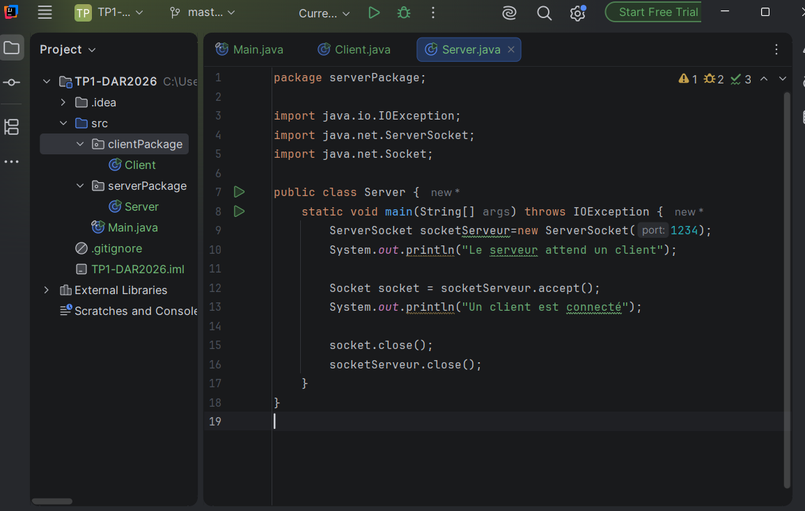

### Lancement du serveur
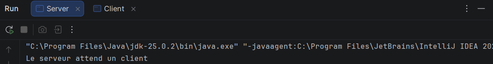

**Interprétation** : Le serveur se met en écoute sur le port 1234 et attend les connexions des clients.

### Code du client 
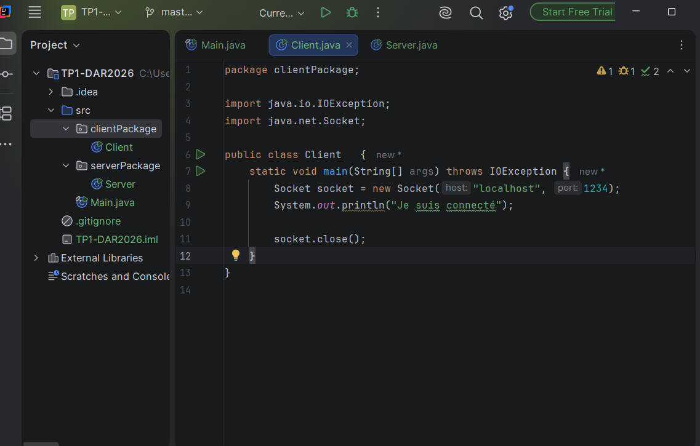

### Lancement du client 
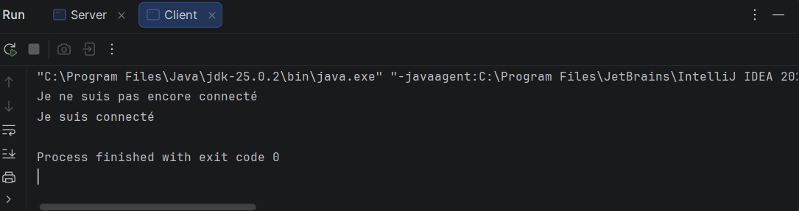

**Interprétation** : Le client se connecte à l'adresse localhost sur le port 1234.

### Connexion établie
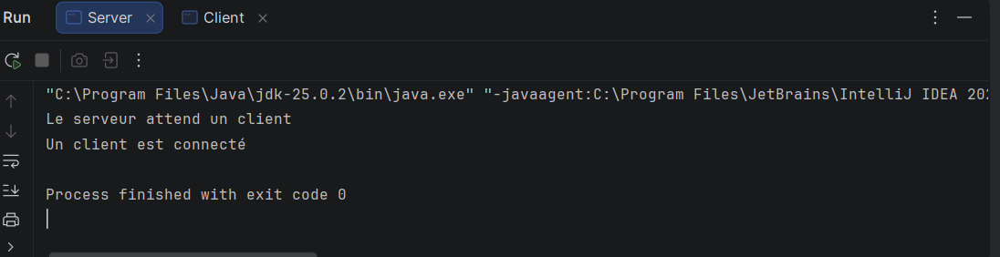

**Interprétation** : La connexion est établie avec succès, le serveur et le client peuvent communiquer.

### Changement d'adresse IP au lieu de localhost 
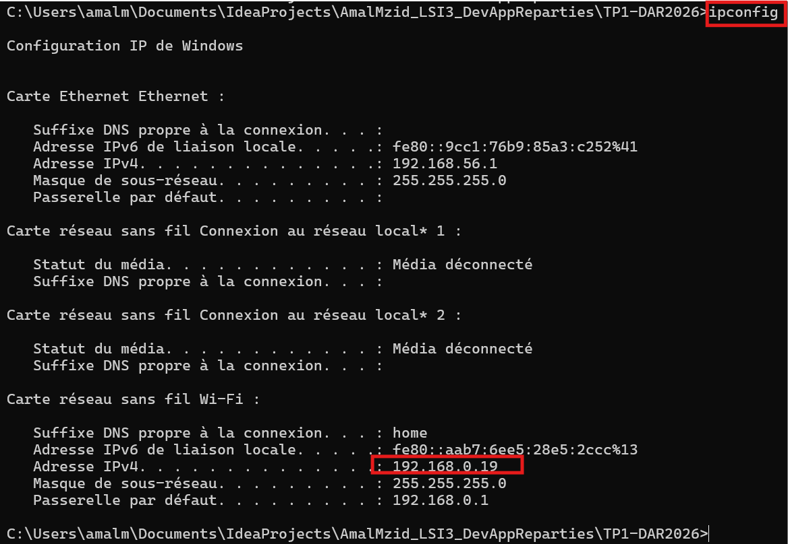

**Interprétation** : Commande ipconfig pour récupérer l'adresse IP de la machine.

### Code et exécution avec adresse IP
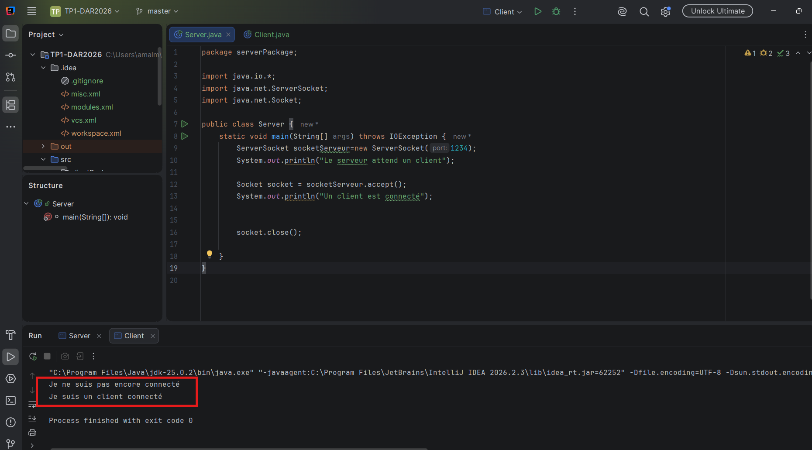

**Interprétation** : Le serveur utilise l'adresse IP locale pour accepter les connexions.

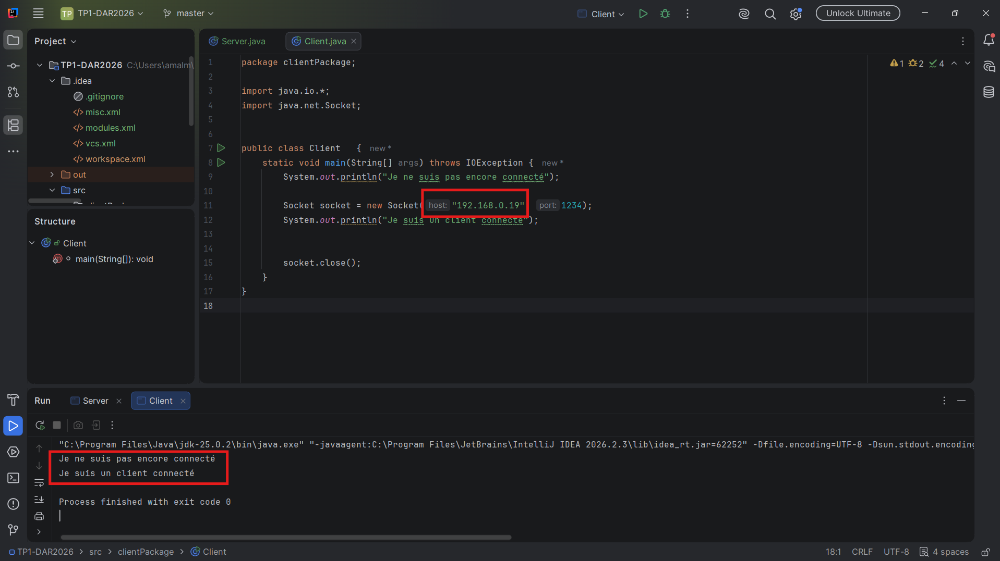

**Interprétation** : Le client se connecte en utilisant l'adresse IP du serveur au lieu de localhost.

---

# TP1 - Activité 2 - Applications Réparties

## Description
Cette activité étend l'application client-serveur en ajoutant un traitement des nombres envoyés par le client : le serveur multiplie la valeur envoyée par 5.

## Execution

### Code du serveur
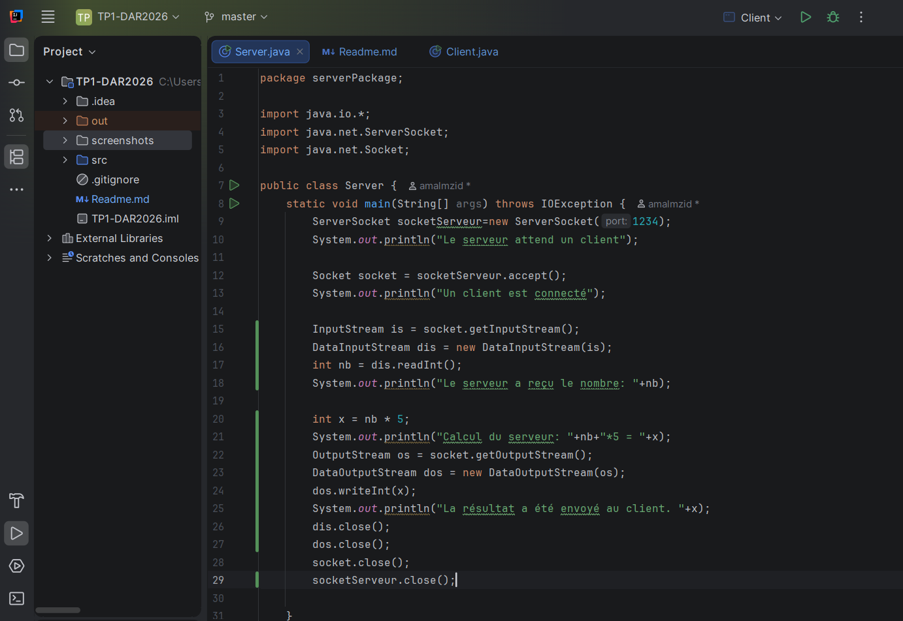

**Interprétation** : Le serveur reçoit un nombre du client, le multiplie par 5 et renvoie le résultat.

### Lancement du serveur
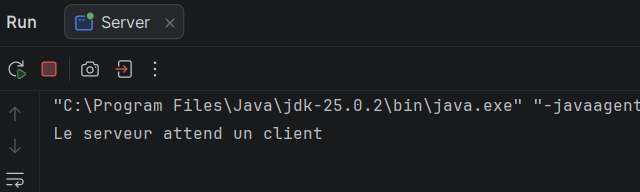

**Interprétation** : Le serveur se lance et attend la connexion d'un client sur le port 1234.

### Code du client
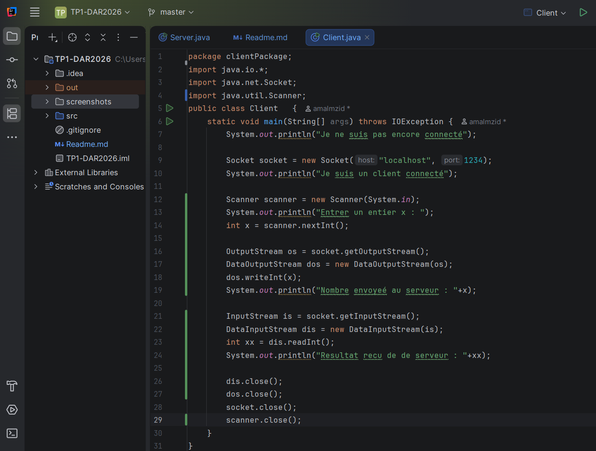

**Interprétation** : Le client se connecte au serveur et permet à l'utilisateur d'entrer un nombre.

### Lancement du client
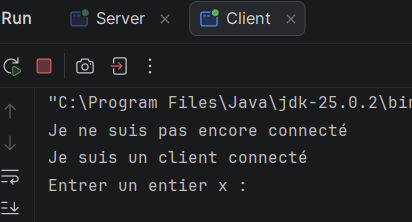

**Interprétation** : Le client se connecte avec succès au serveur et attend l'entrée d'un nombre.

### Client envoie 0
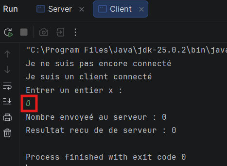

**Interprétation** : Le client envoie 0, le serveur le multiplie par 5 (0 × 5 = 0) et renvoie le résultat.

### Client envoie un nombre négatif
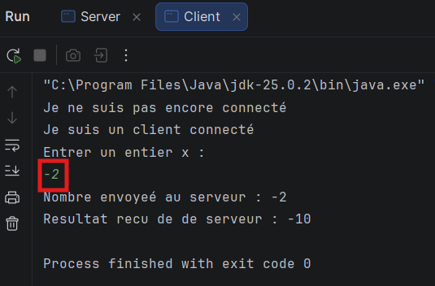

**Interprétation** : Le client envoie un nombre négatif, le serveur le multiplie par 5 et renvoie le résultat (exemple : -3 × 5 = -15).

### Client envoie un nombre (ex: 5)
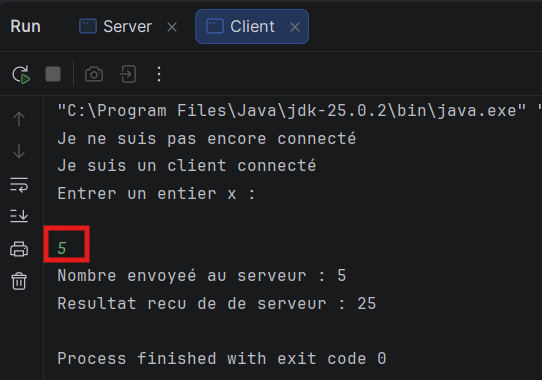

**Interprétation** : Le client envoie le nombre 5 au serveur, qui le multiplie par 5 (5 × 5 = 25) et renvoie le résultat.

### Serveur après réponse
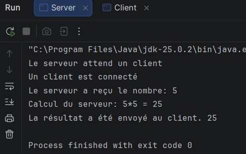

**Interprétation** : Le serveur affiche le nombre reçu et le résultat de la multiplication.

---

## multiplication avec plusieurs entiers

### Code du serveur modifié
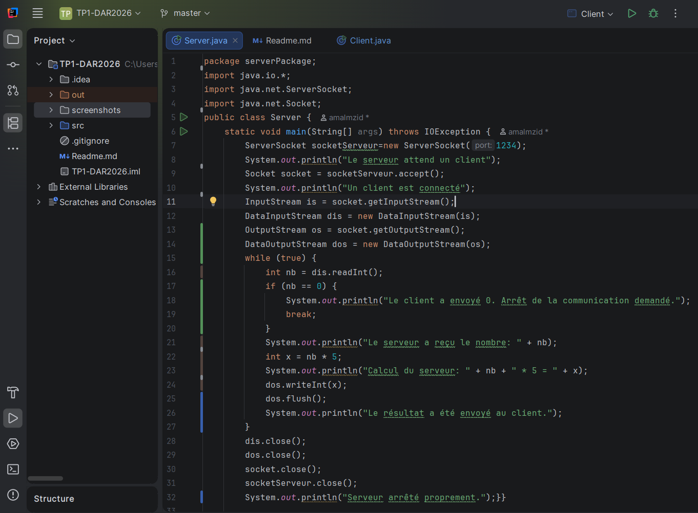

**Interprétation** : Le serveur utilise une boucle pour traiter plusieurs nombres consécutifs envoyés par le client. Il continue à multiplier chaque nombre par 5 tant que le client envoie des données.

### Lancement du serveur
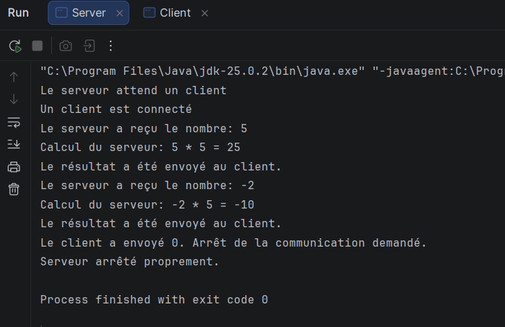

**Interprétation** : Le serveur se lance et attend la connexion d'un client. Il est prêt à traiter plusieurs nombres consécutifs.

### Code du client modifié
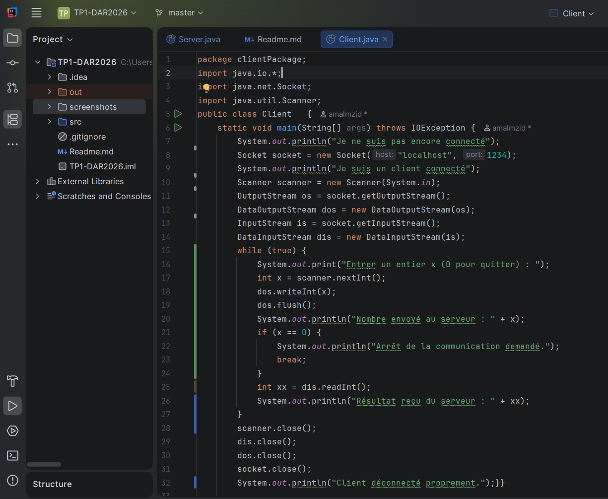

**Interprétation** : Le client utilise une boucle pour permettre à l'utilisateur de saisir plusieurs entiers successivement. La boucle se termine lorsque l'utilisateur saisit 0.

### Lancement du client avec multiplications multiples
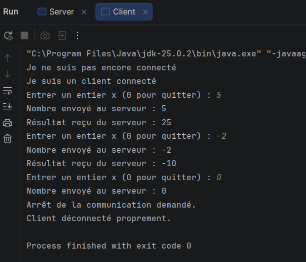

**Interprétation** : Le client se connecte au serveur et permet à l'utilisateur de saisir plusieurs nombres. Chaque nombre est envoyé au serveur, multiplié par 5, et le résultat est affiché. Le processus se termine automatiquement lorsque l'utilisateur saisit 0, fermant proprement la connexion.

---

# TP1 - Activité 3 - Applications Réparties sur Machines Distinctes

## Description (Partie 1)
Cette activité consiste à installer et exécuter le Client et le Serveur sur deux machines distinctes du même réseau local.
## Configuration de la VM

### Lancement de la VM
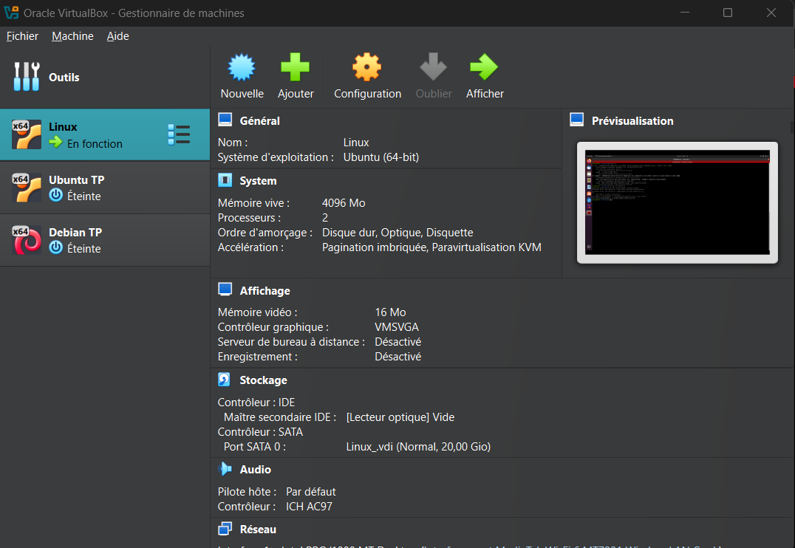

**Interprétation** : La machine virtuelle est lancée et prête à être configurée.

### Changement du mode réseau en Bridge
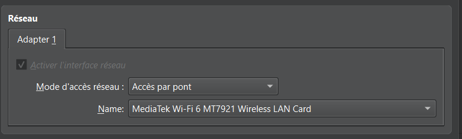

**Interprétation** : Le mode réseau de la VM est configuré en mode Bridge pour permettre la communication directe avec le réseau local.

### Récupération de l'adresse IP de la VM et ping vers la machine hôte
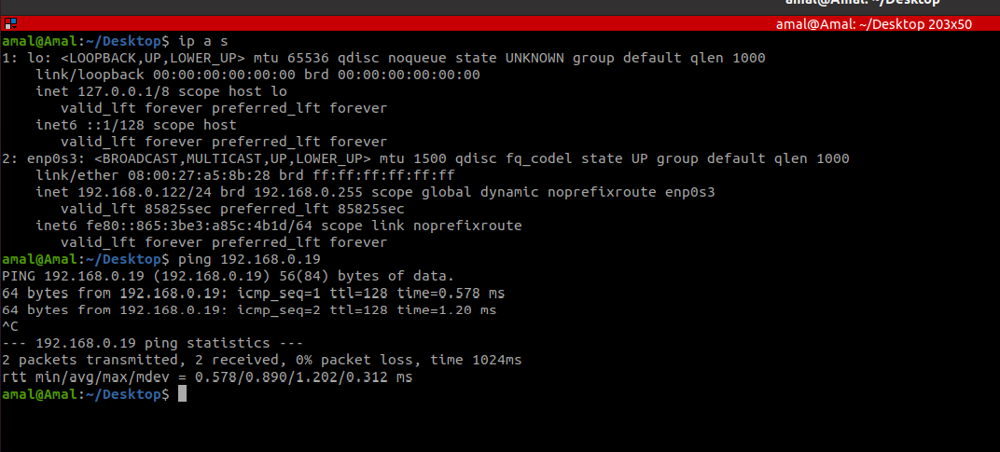

**Interprétation** : L'adresse IP de la VM est récupérée (192.168.0.122) et la connectivité avec la machine hôte est vérifiée par ping.

### Récupération de l'adresse IP de la machine hôte et ping vers la VM
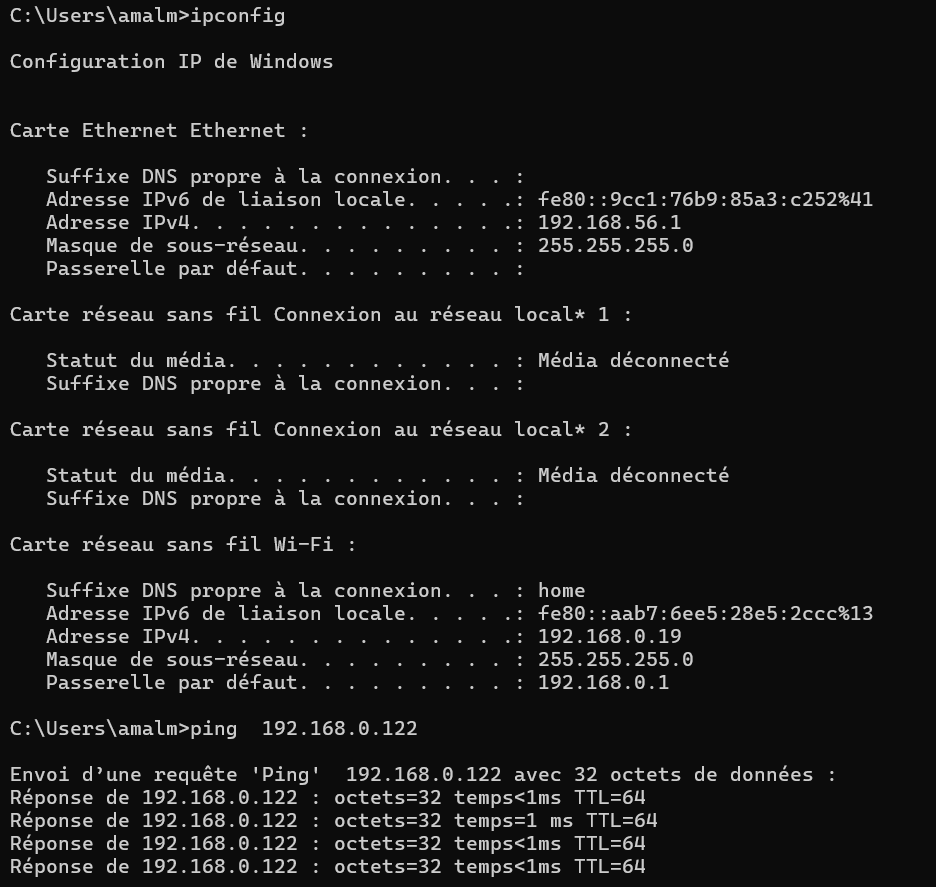

**Interprétation** : L'adresse IP de la machine hôte est récupérée et la connectivité avec la VM est vérifiée par ping.

### Configuration du pare-feu - Autorisation du port 1234
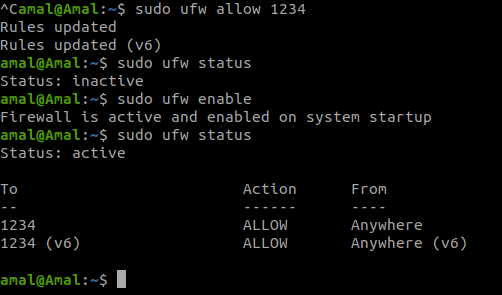

**Interprétation** : Le pare-feu UFW est activé et le port 1234 est autorisé pour permettre les connexions entrantes sur le serveur.

## Code du Serveur

### Code du serveur avec InetAddress
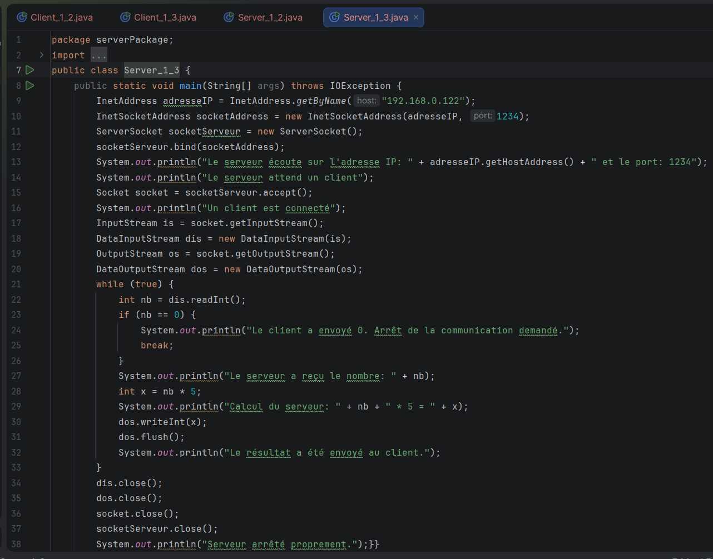

**Interprétation** : Le serveur utilise `InetAddress.getByName("192.168.0.122")` pour définir l'adresse IP et `InetSocketAddress` pour combiner l'IP et le port. Le ServerSocket est bindé à cette adresse spécifique.

## Code du Client

### Code du client avec InetAddress
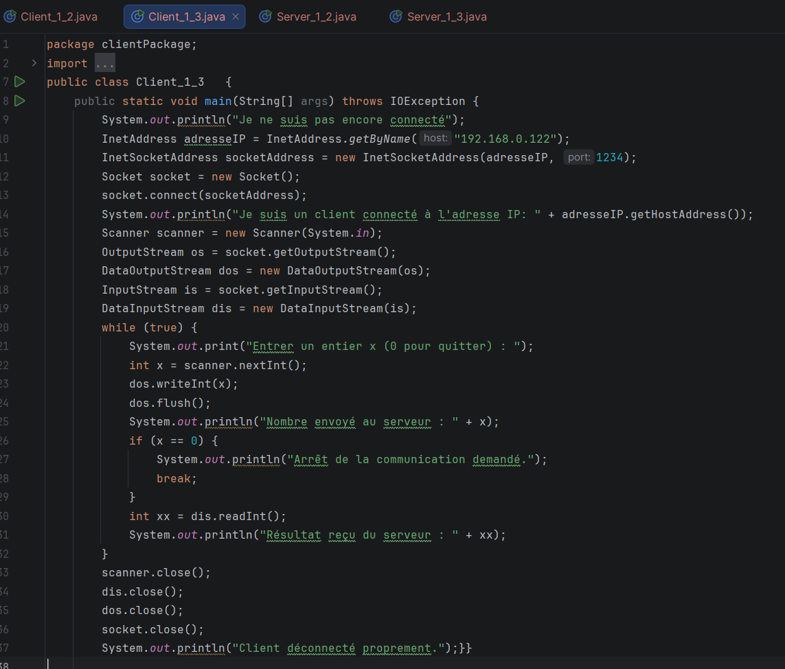

**Interprétation** : Le client utilise `InetAddress.getByName("192.168.0.122")` pour se connecter au serveur sur la VM au lieu de localhost.

## Exécution

### Copie du serveur vers la VM via SCP
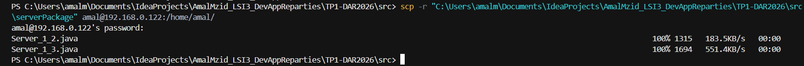

**Interprétation** : Le fichier Server_1_3.java est copié de la machine hôte vers la VM en utilisant la commande SCP.

### Compilation et exécution du serveur sur la VM
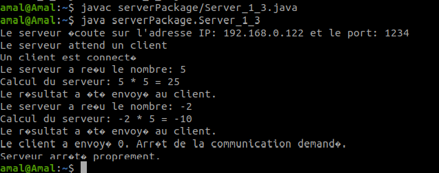

**Interprétation** : Le serveur est compilé et exécuté sur la VM. Il écoute sur l'adresse IP 192.168.0.122 et le port 1234, attendant les connexions des clients.

### Compilation et exécution du client sur la machine hôte
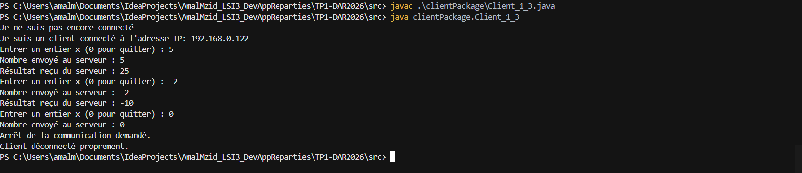

**Interprétation** : Le client est compilé et exécuté sur la machine hôte. Il se connecte au serveur sur la VM via l'adresse IP 192.168.0.122 et peut envoyer des nombres pour multiplication.

---

## Description (Partie 2)
Cette partie améliore le service de calculatrice pour offrir au client quatre opérations de calcul possibles : Addition, Soustraction, Multiplication, et Division.
## Code du Serveur (Partie 2)

### Code du serveur avec menu de calculatrice
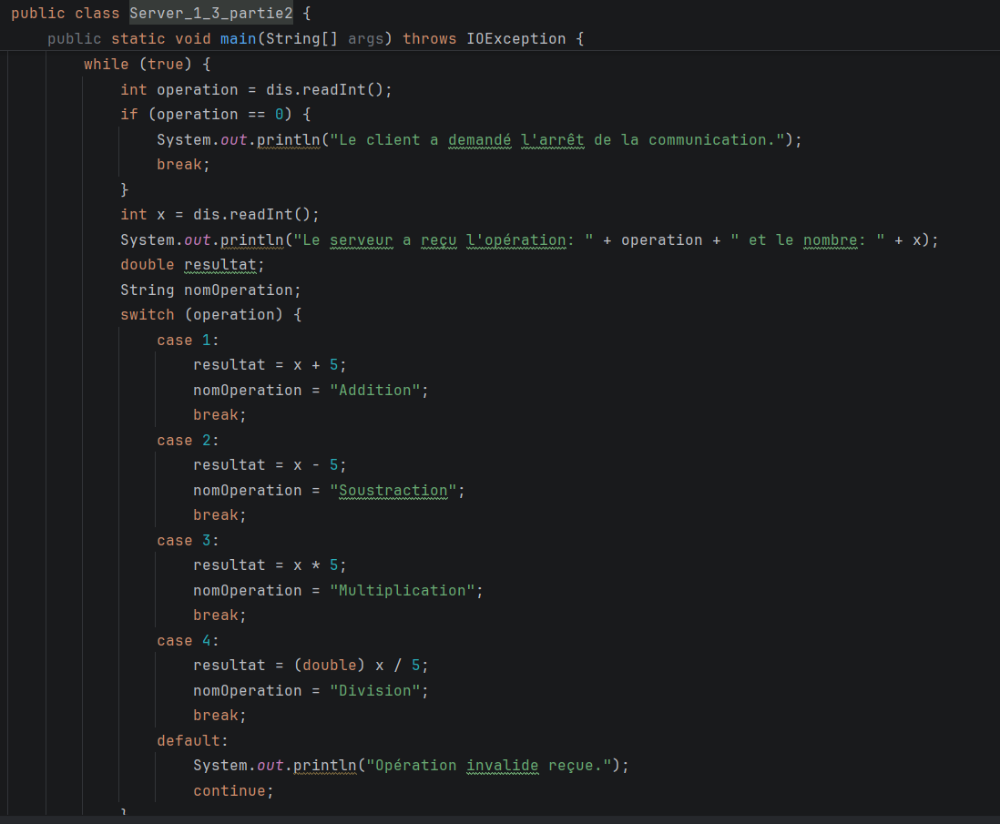

**Interprétation** : Le serveur reçoit l'opération choisie (1-4) et le nombre x du client. Il effectue le calcul selon l'opération (Addition: x+5, Soustraction: x-5, Multiplication: x*5, Division: x/5) et renvoie le résultat.

## Code du Client (Partie 2)

### Code du client avec menu de calculatrice
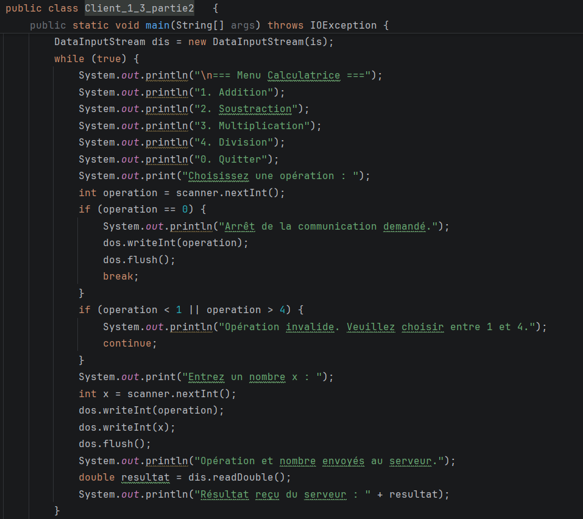

**Interprétation** : Le client affiche un menu avec 4 opérations possibles. L'utilisateur choisit l'opération et entre un nombre x. Le client envoie l'opération et le nombre au serveur, puis affiche le résultat reçu.

## Exécution (Partie 2)

### Lancement du serveur
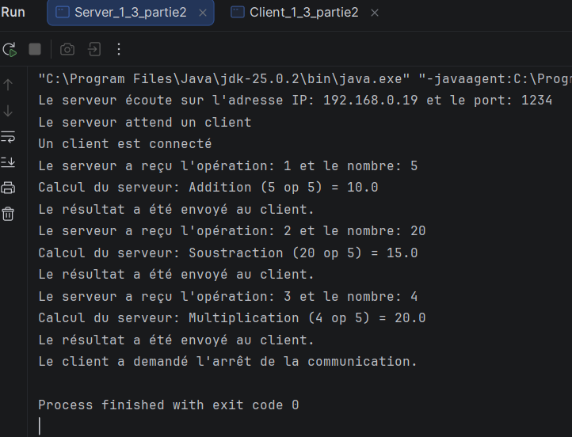

**Interprétation** : Le serveur est lancé et attend les connexions des clients. Il est prêt à traiter les demandes de calcul avec le menu de calculatrice.

### Lancement du client
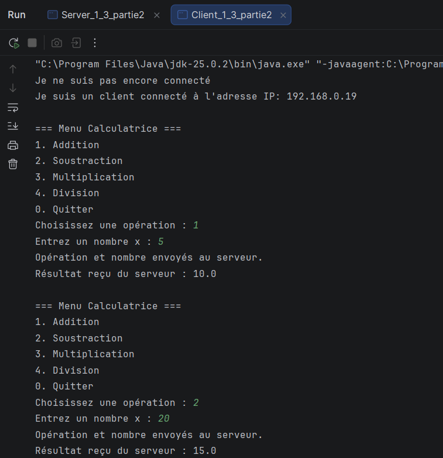

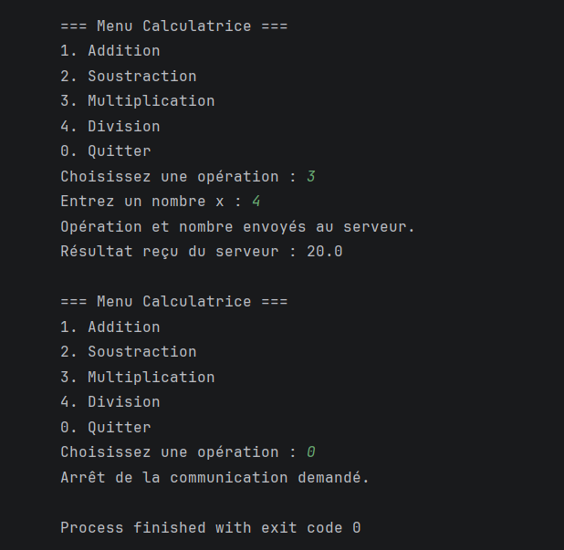

**Interprétation** : Le client teste l'application avec différentes opérations.

